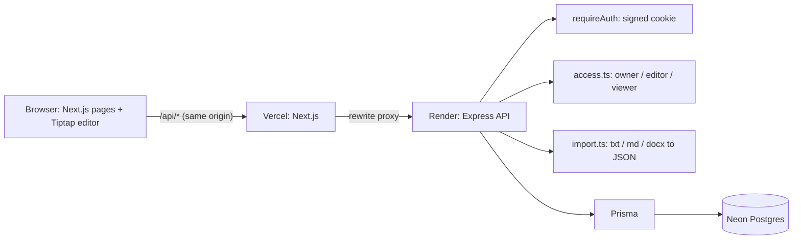

# Architecture Note

## What I prioritized, and why

The brief asks for a coherent product slice rather than a Docs clone, so I aimed to go deep on the parts that make a document tool trustworthy, and stay shallow everywhere else.

1. **Never lose or corrupt someone's work.** Content is stored as the editor's own JSON, not HTML, so formatting comes back exactly. Saves happen automatically, and a version check stops one user from silently overwriting another.
2. **Access rules that are obviously correct.** All permission decisions live in one small, pure module (`backend/src/lib/access.ts`) that every route goes through, and the tests cover every role against every action.
3. **A usable editor.** The toolbar shows the current formatting state, and the page shows whether changes are saved. Viewers get a clear read-only mode. Errors are written for people, not developers.
4. **Easy for reviewers to run.** There are seeded users with two sharing roles already set up, one URL to test, free hosting, and a login page that copes with a sleeping free-tier server.

## System overview



- **Two repos, two deployments.** The Next.js frontend (Vercel) only renders the UI. The Express API (Render) owns all business logic and data.
- **One origin for the browser.** Next.js rewrites `/api/*` to the Express service. The session cookie is therefore first-party (`HttpOnly`, `Secure`, `SameSite=Lax`), so there's no CORS configuration and no third-party-cookie problems.
- **No build step on the API.** `tsx` runs the TypeScript directly, which keeps the setup simple for a project this size.

## Data model

```
User           id, email (unique), name
Document       id, title, content (JSON), version, ownerId -> User, createdAt, updatedAt
DocumentShare  documentId -> Document, userId -> User, role (VIEWER | EDITOR), unique(documentId, userId)
```

- Ownership is a column on `Document`, not a share row, so a document always has exactly one owner.
- Deleting a document deletes its shares too (cascade).

## Access rules

| Role        | Read | Edit content and title | Share and change roles | Delete |
| ----------- | ---- | ---------------------- | ---------------------- | ------ |
| Owner       | yes  | yes                    | yes                    | yes    |
| Editor      | yes  | yes                    | no                     | no     |
| Viewer      | yes  | no                     | no                     | no     |
| Anyone else | 404  | 404                    | 404                    | 404    |

Users without access get **404, not 403**, so they can't discover that a private document exists. The UI follows the same rules: editors don't see the Share button, and viewers get a non-editable editor with no toolbar. The server checks permissions again on every request either way.

## Saving and conflicts

- The editor autosaves the whole document about 0.8 seconds after the user stops typing. It also saves straight away if the user navigates back before then, and the browser warns before closing a tab with unsaved changes.
- Every save sends the `version` the client last loaded. The server runs `UPDATE ... WHERE id = ? AND version = ?`, then increments the version.
  - If someone else saved in between, no row matches and the API returns **409**.
  - The UI then stops saving and shows a "Reload" banner.
- Saves from one tab are queued (`useDocumentSaver`), so a rename and an autosave can never race each other or conflict with themselves.

**Why not real-time collaboration?** Live co-editing needs CRDTs or OT, websockets, and presence. That's a project on its own, and doing it badly is worse than not doing it. Optimistic versioning is honest and cheap, and it guarantees nobody's work is overwritten silently. It's the first thing I would replace with Yjs given more time.

## File import

- Supported files are .txt, .md and .docx, up to 2 MB. Each import creates a **new document** owned by the uploader and titled after the file.
- Conversion runs on the server:
  - Markdown goes through `marked`, and Word files through `mammoth`, to produce HTML.
  - `@tiptap/html` then converts that HTML into editor JSON, using **the same extensions as the editor**.
  - Plain text becomes one paragraph per line.
- Because the conversion only keeps nodes the editor schema knows about, anything risky like `<script>` or `onerror` is dropped automatically, and there's a test for it.
- The type and size are checked in the browser (for fast feedback) and again on the server (for safety).

## Validation and error handling

- **Server:** zod schemas validate every request body. A central error handler turns every error into `{ error }` with the right status code: 400, 401, 403, 404, 409 or 413, or 500 with a generic message. Environment variables are validated at startup.
- **Client:** one API wrapper turns failures into readable messages, including when the network is down or a proxy returns an HTML error page. It also sends expired sessions back to the login page.
- **Feedback in the UI:**
  - The results of actions appear as toasts (`useToast`): success and failure for sharing, removing access, importing, deleting and copying links.
  - Errors in a form stay next to that form.
  - Problems that persist, such as a save conflict or view-only access, stay as banners until resolved.
  - Destructive actions use an in-app `ConfirmDialog`, never the browser's `confirm()`.
  - The only browser-native prompt left is the "leave page with unsaved changes?" warning, because browsers do not allow pages to replace it.

## Testing strategy

| Layer                       | Tool                              | Count | Focus                                                                        |
| --------------------------- | --------------------------------- | ----- | ---------------------------------------------------------------------------- |
| Backend unit                | Vitest                            | 44    | Access matrix, validation edge cases, importer (real .docx, unsafe Markdown) |
| Backend API                 | Vitest + supertest, real Postgres | 51    | Every endpoint, permissions, conflicts, upload limits                        |
| Frontend unit and component | Vitest + Testing Library          | 50    | API client, autosave queue, toolbar with a real editor, share dialog, UI kit |
| End-to-end                  | Playwright (Chrome)               | 11    | The full user journeys with two users at once                                |

I also checked that the tests can fail. I deliberately broke the access rules and the version check, and confirmed that the right tests went red.

## Tradeoffs and known limitations

- **Mocked auth:** anyone can sign in as any seeded user. This is fine for a demo and clearly labelled in the UI.
- **Whole-document saves:** each save sends the full JSON, which is simple and fine for normal document sizes (the request limit is 1 MB).
- **Sharing only with existing accounts:** there are no email invitations.
- **Free-tier cold starts:** the login page retries for up to about 90 seconds and explains the wait.
- **Prisma 6, not the latest major version:** the Prisma 7/8 upgrade brings breaking changes I didn't want to take on in a timebox. The remaining audit warning is in the Prisma CLI's config loader, which isn't used at runtime.

## What I would build next (with 2–4 more hours)

1. Real-time co-editing with Yjs and a small websocket server, plus presence (who is viewing).
2. Version history: keep a snapshot per save in a `DocumentVersion` table, with a restore button.
3. Export to Markdown or PDF, reusing the same conversion pipeline in reverse.
4. Real authentication (e.g. email magic links), and invitations for people without an account.
5. Comments anchored to text ranges.
