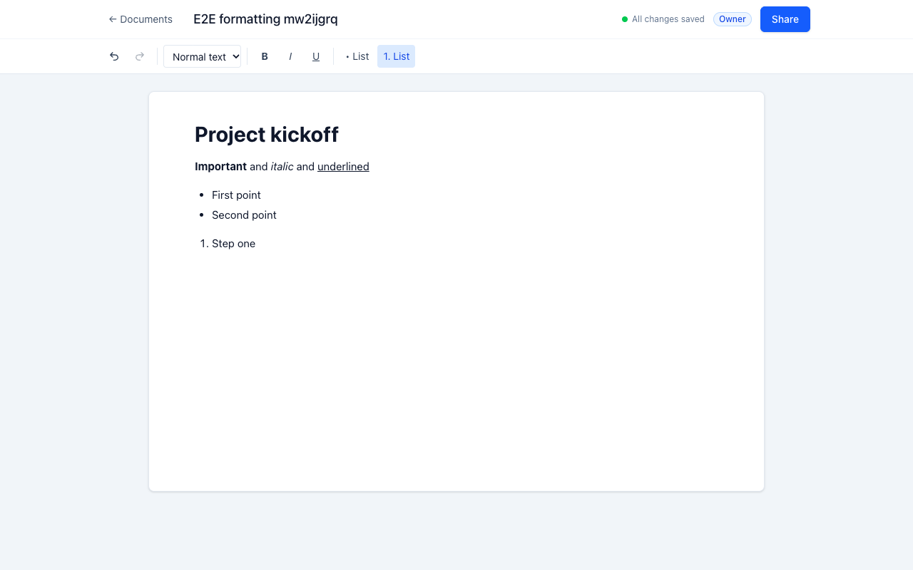
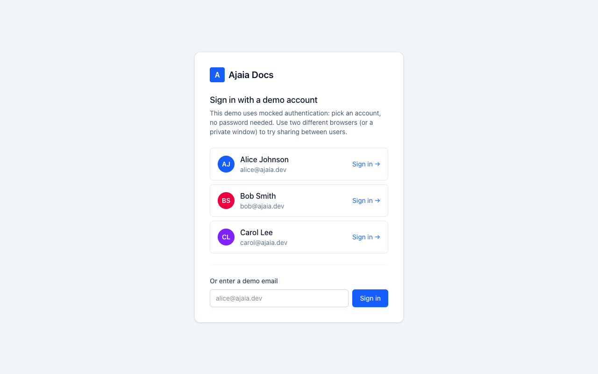
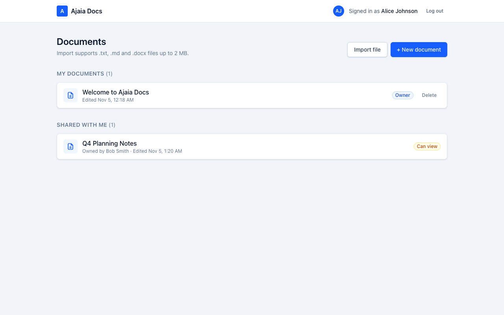
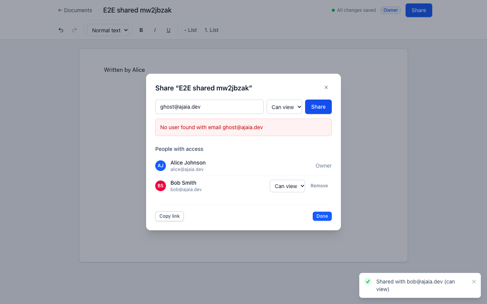
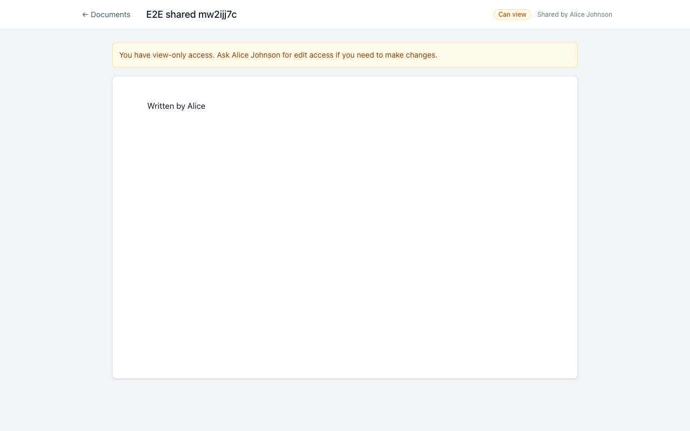
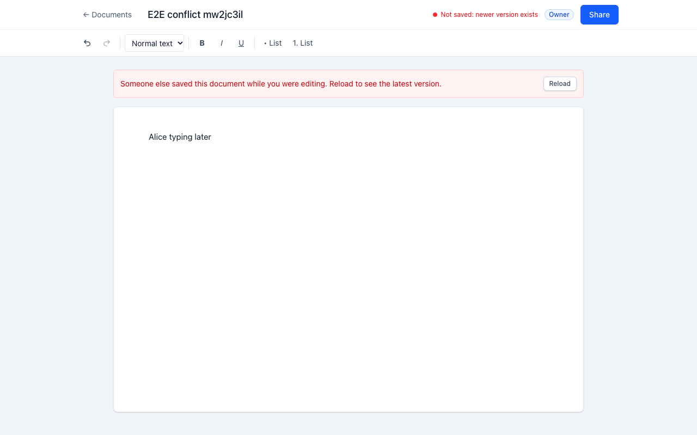
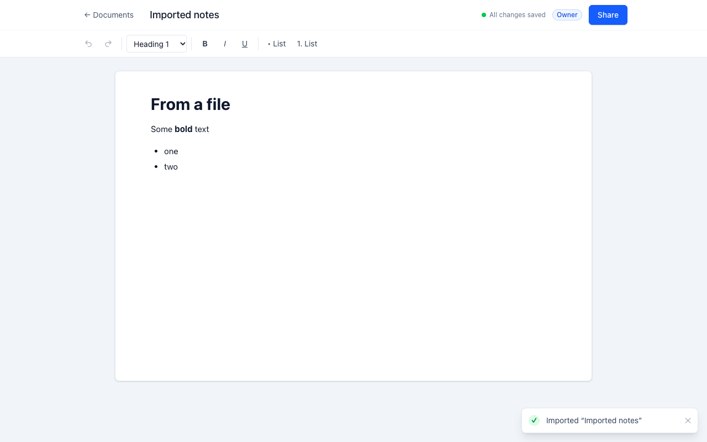
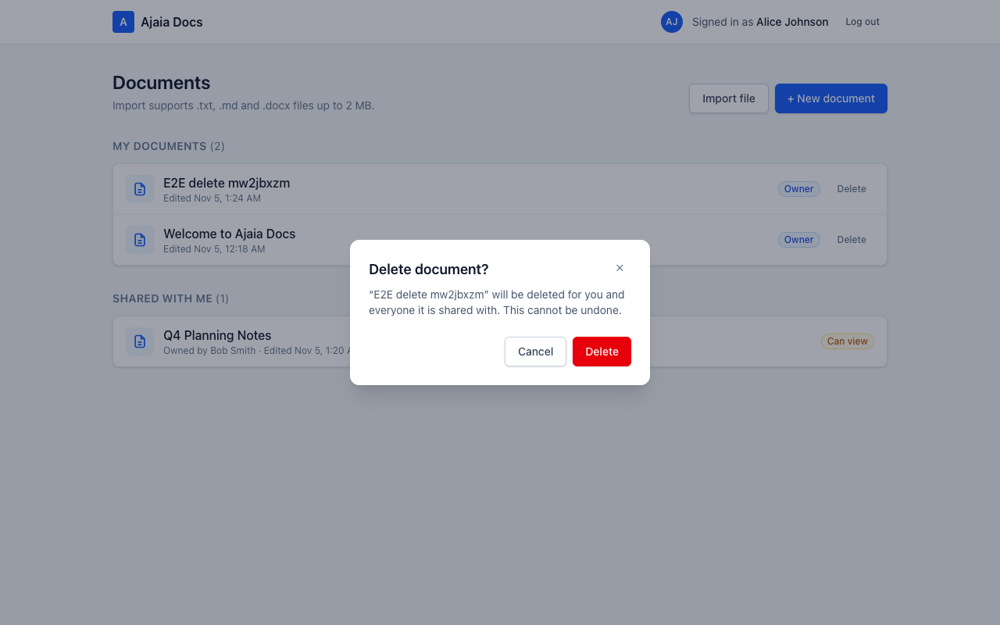

# Ajaia Docs

A lightweight collaborative document editor, inspired by Google Docs and built for the Ajaia AI-Native Full Stack Developer assignment.

- **Live app:** https://ajaia-green.vercel.app (see [Demo accounts](#demo-accounts))
- **Live API health check:** https://ajaia-assignment-backend-o0mu.onrender.com/api/health
- **Frontend (this repo):** Next.js + Tiptap, deployed on Vercel
- **Backend:** [Ajaia-assignment-backend](https://github.com/PKSharma96/Ajaia-assignment-backend), Express + Prisma + Postgres, deployed on Render + Neon
- **More docs:** [ARCHITECTURE.md](ARCHITECTURE.md) · [AI_WORKFLOW.md](AI_WORKFLOW.md) · [SUBMISSION.md](SUBMISSION.md)

> The backend runs on Render's free tier, which sleeps when idle. If the login page says the server is waking up, wait up to a minute and it will continue on its own.



## Demo accounts

Login is mocked: click an account on the login page, no password needed.

| Account             | What to try                                                                                         |
| ------------------- | --------------------------------------------------------------------------------------------------- |
| **alice@ajaia.dev** | Owns "Welcome to Ajaia Docs" (shared with Bob as **editor**). Can _view_ Bob's "Q4 Planning Notes". |
| **bob@ajaia.dev**   | Owns "Q4 Planning Notes" (shared with Alice as **viewer**). Can _edit_ Alice's welcome doc.         |
| **carol@ajaia.dev** | Starts with nothing. Share something with her to test sharing from scratch.                         |

To test sharing, use **two browsers** (or one normal window and one private window) so each can be signed in as a different user.

## What works

| Area                  | Details                                                                                                                                                                                                                                                                                                                                                                                                                                                                               |
| --------------------- | ------------------------------------------------------------------------------------------------------------------------------------------------------------------------------------------------------------------------------------------------------------------------------------------------------------------------------------------------------------------------------------------------------------------------------------------------------------------------------------- |
| Documents             | Create, rename (click the title), edit, delete (owner only), and reopen. Changes **autosave** about 1 second after you stop typing, and a status shows Saving… / All changes saved.                                                                                                                                                                                                                                                                                                   |
| Rich text             | Bold, italic, underline, Heading 1–3 / normal text, bulleted and numbered lists, undo/redo. Keyboard shortcuts work too (Ctrl/Cmd+B, I, U).                                                                                                                                                                                                                                                                                                                                           |
| File import           | **.txt, .md, .docx up to 2 MB** become a new editable document. Headings, lists, bold, italic and underline are kept. Images, tables and colours are dropped (their text is kept). Other file types get a clear error. Ready-made test files are in [`samples/`](samples).                                                                                                                                                                                                            |
| Sharing               | The owner shares by email as **Can edit** or **Can view**, can change the role later, or remove access. The dashboard separates **My documents** from **Shared with me** and shows the owner and your role. Viewers get a read-only editor. Users without access get "not found", so private documents stay hidden.                                                                                                                                                                   |
| Persistence           | PostgreSQL. Content is stored as the editor's own JSON format, so formatting comes back exactly after a refresh.                                                                                                                                                                                                                                                                                                                                                                      |
| Conflicts             | If two people edit the same document, the second save is rejected (it would otherwise silently overwrite) and the user is asked to reload.                                                                                                                                                                                                                                                                                                                                            |
| Validation and errors | Every request is validated on the server. Results of actions (shared, removed, imported, deleted, link copied, failures) appear as **toast notifications**. Form errors are shown next to the form, with the server's message (e.g. "No user found with email …"). Deleting asks for confirmation in an in-app dialog. Empty titles are refused with a message, leaving the page with unsaved changes asks for confirmation, and a sleeping server is retried automatically on login. |

## Sample files for import

The [`samples/`](samples) folder has one file of each supported type. On the dashboard, click **Import file** and pick one.

| File                             | What it shows after import                                             |
| -------------------------------- | ---------------------------------------------------------------------- |
| `Team meeting notes.txt`         | Plain text: each line becomes a paragraph (no formatting)              |
| `Product launch plan.md`         | Headings (H1–H3), bold, italic, underline, bulleted and numbered lists |
| `Quarterly business review.docx` | Word headings, bold, italic, underline, bulleted and numbered lists    |

The document title comes from the file name, e.g. "Product launch plan".

## What is intentionally not included

- **Real-time co-editing** (live cursors, merging keystrokes). This needs CRDTs and websockets, which was too much for the timebox. Conflicting saves are detected instead (see above).
- **Real authentication.** Seeded accounts with a signed session cookie show the sharing model without passwords or OAuth.
- Comments, version history, export, images, tables, and PDF import.

See [ARCHITECTURE.md](ARCHITECTURE.md) for the reasoning, and for what I would build next.

## Run locally

You need Node 20.9+ and Docker (or a local PostgreSQL).

**1. Backend**, in its own folder:

```bash
git clone https://github.com/PKSharma96/Ajaia-assignment-backend.git
cd Ajaia-assignment-backend
npm install
docker compose up -d
cp .env.example .env && cp .env.test.example .env.test
npx prisma migrate dev
npm run seed
npm run dev                        # API on http://localhost:4000
```

**2. Frontend** (this repo), in a second terminal:

```bash
npm install
cp .env.example .env.local         # API_URL=http://localhost:4000
npm run dev                        # open http://localhost:3000
```

The frontend forwards every `/api/*` request to `API_URL` (see `next.config.mjs`), so the browser only ever talks to one origin.

## Tests

| Command                        | What it covers                                                                                                                                                                                                                                                                                                                                                                                            |
| ------------------------------ | --------------------------------------------------------------------------------------------------------------------------------------------------------------------------------------------------------------------------------------------------------------------------------------------------------------------------------------------------------------------------------------------------------- |
| `npm test` (this repo)         | **50 tests**: the API client (error messages, 401 redirect, uploads), upload validation, the autosave queue and conflict handling, the toolbar against a real Tiptap editor, the share dialog, toasts, the confirm dialog and the other shared UI components.                                                                                                                                             |
| `npm run test:e2e` (this repo) | **11 Playwright tests** in real Chrome against the running app. They cover login, the dashboard split, create/format/autosave/reopen, deleting with confirmation, empty-title handling, the viewer/editor/revoke sharing flow, privacy, conflict handling, and import (including the sample .docx). Requires both apps running with seeded data. Set `E2E_BASE_URL` to run them against the deployed app. |
| `npm test` (backend repo)      | **95 tests**: unit tests for access rules, validation and the importer, plus API tests for every endpoint and its edge cases.                                                                                                                                                                                                                                                                             |

Other checks: `npm run lint`, `npm run typecheck`, `npm run format`.

## Screenshots

|                                                                |                                                                 |
| -------------------------------------------------------------- | --------------------------------------------------------------- |
|                         |                  |
|           |              |
|                   |  |
|  |                                                                 |

The screenshots are generated by the E2E tests: `SCREENSHOTS=1 npm run test:e2e`.

## Deploy

1. **Backend:** follow the "Deploy" section of the backend README (Neon database, then a Render Blueprint).
2. **Frontend:** import this repo on [Vercel](https://vercel.com) and set one environment variable, `API_URL=https://<your-render-service>.onrender.com`. No other settings are needed.

## Project layout

```
src/
  app/login/page.tsx           demo account picker, waits for a sleeping server
  app/documents/page.tsx       dashboard: My documents / Shared with me, new, import
  app/documents/[id]/page.tsx  loads a document, handles "not found"
  components/editor/           DocumentEditor (title, autosave, banners), Toolbar, useDocumentSaver
  components/ShareDialog.tsx   share by email, change role, remove access, copy link
  components/ui/               small reusable pieces: Button, Alert, Avatar, Spinner, Toast, Modal, ConfirmDialog
  lib/api.ts                   typed API client with friendly error messages
  lib/upload.ts                client-side file checks (same limits as the server)
tests/                         Vitest + Testing Library
e2e/                           Playwright end-to-end tests
```
